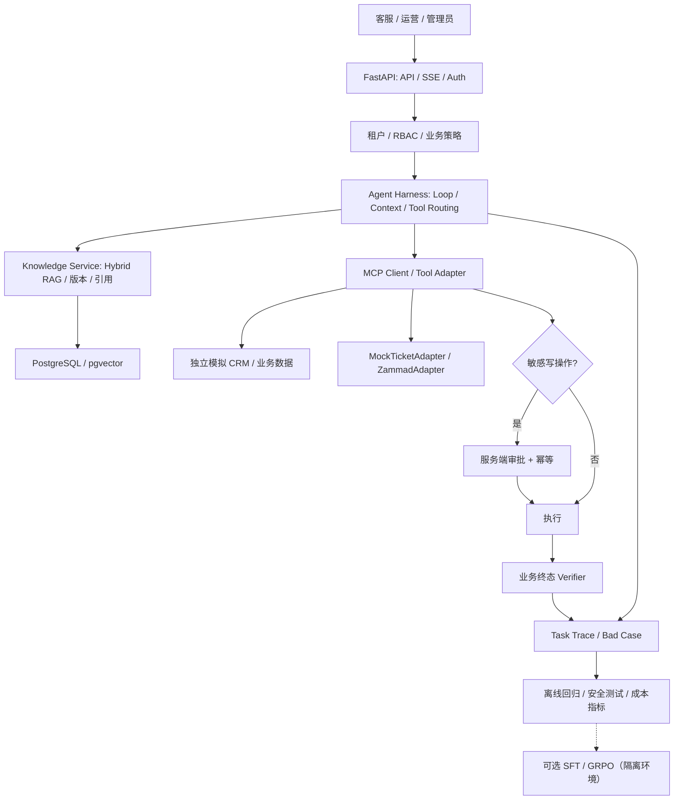

# Enterprise AgentOps-RL

> **面向企业客服与工单处理的可信 Agent Harness + AgentOps 平台**：把“会回答”的大模型，变成能够检索现行知识、查询业务状态、受控执行工单、验证结果并持续改进的服务系统。

**主业务场景：模拟金融企业的客户服务与工单处理（ServiceOps）**  
**项目性质：公开数据 + 模拟业务系统的可复现工程/算法作品，不宣称真实企业投产**  
**计划：2026-10-26 — 2027-01-17（12 周；前 7 天冲刺 L1/L2 核心原型）**  
**资源：本地 WSL2 / PostgreSQL + pgvector，已有算力优先；额外预算约 ¥0–100/月**

## 先解决什么业务问题？

传统客服/运营人员往往需要先查政策，再进入业务系统核实客户状态，最后开单或转人工。普通 RAG 只能回答问题；普通 Agent Demo 可能未经核验就调用写工具。我们实现一条**可控制、可恢复、可验收的业务闭环**：

1. 接收客户咨询，确定业务类型及已知信息。
2. 按身份、租户、有效期检索政策，输出可追溯引用。
3. 通过授权的 MCP/Connector 查询模拟客户、申请与工单状态。
4. 信息不足时追问；不可确认时拒答/转人工；敏感写操作需授权审批。
5. 对可执行任务创建/更新工单，使用幂等键防止重复副作用。
6. 用**独立于 Agent 的数据库终态 Verifier**校验结果，保存 Trace、失败原因和成本。
7. 将坏案例回流为固定回归测试，之后再进行系统消融或模型训练。

具体角色、状态、接口、验收和非目标见 [业务需求与验收（PRD）](docs/PRODUCT_SCOPE.md)。

## 设计原则

- **业务驱动而不是框架驱动**：首版只做金融客服与工单，不做通用“万能 Agent”。
- **Harness 优先，LangGraph 可选**：Agent Loop、上下文管理、Tool Calling 和验证逻辑使用可替换接口；LangGraph 仅用于需要状态图、审批中断和持久化恢复的流程。
- **模型负责非确定性决策，后端负责权威规则**：权限、事务、租户隔离、审批、幂等、终态判定不得由 Prompt 保证。
- **真实集成证明**：先用独立的模拟 CRM/工单 API 验收，再争取对接 [Zammad](https://zammad.org/) 等开源工单系统；适配器可替换。
- **可证伪的指标**：不把对话结束视为任务成功，不把“回答准确率”代替真实业务状态，不预先宣称效果提升。
- **实习作品的完成标准是 L3**：L1/L2 构建原型与可靠性，L3 有固定基线、实验、Bad Case 与交付证据；L4 SFT/GRPO 是可选算法扩展。

## 总体架构

**重要边界：** MCP 工具只有明确的受控能力；外部检索文档属于不可信输入。用户授权和敏感写入的决定由确定性后端作出。独立 Verifier 不应读取 Agent 生成的“自我评分”作为成功依据。

## L1–L4 里程碑

| 层级 | 目标 | 完成标准 |
|---|---|---|
| **L1：端到端业务 MVP** | FastAPI + PostgreSQL + 带证据的 RAG + 单 Agent + 工单 Mock | 真实模型执行至少一条咨询→查政策→查状态→受控工单流程；任务结果可在数据库查验 |
| **L2：可靠的企业 Harness** | 2 租户、JWT/RBAC、审批、幂等、失败恢复、Trace | 预先定义的越权/重复提交/工具故障/中断测试通过；不能将一周原型称作生产级 |
| **L3：可交付、可评测** | 检索和 Agent 基线、独立终态校验、Bad Case、外部系统适配、部署与性能 | 固定任务集和多组可复现对照实验；可展示运营台、失败分析与成本；**求职项目的主要完成标准** |
| **L4：Agentic RL（可选）** | 隔离轨迹、SFT/LoRA、小规模 GRPO | 对 Base/SFT/RL 做真实测试和安全负例比较；无资源或无增益也如实报告 |

**前 7 天（10/26–11/01）** 冲刺 L1 与 L2 **核心原型**，不是交付成熟的多租户 SaaS。后 9 周重点是质量、业务集成和证据。见 [完整 12 周计划](docs/ROADMAP.md)。

## 首版范围

- **一个业务领域、一个主 Agent、一个 MCP Server、5–8 个受控工具、两个模拟租户、四个运营页面**。
- **公开数据**：[Sierra τ-bench / τ-Knowledge banking_knowledge](https://github.com/sierra-research/tau2-bench) 的模拟业务数据库与知识文档；原数据与新增模拟工单表明确隔离，不虚构为真实银行数据库。
- **关键能力**：文件/版本治理、Hybrid RAG + 可追溯引用、Agent Loop、工具适配器、权限/审批/幂等、任务持久化、独立 Verifier、Bad Case 回归和测试。
- **非目标**：真实金融交易、商业客户数据、私自执行转账/支付、无边界自由 SQL、复杂多 Agent、大规模 K8s 集群以及首周完成后训练。

## 技术选型

| 模块 | 当前选择 | 取舍理由 |
|---|---|---|
| HTTP | Python 3.12、FastAPI、Pydantic、SSE | Python AI 生态、类型校验与前端状态更新 |
| 持久化 | PostgreSQL、SQLAlchemy 2、Alembic、Redis（按需） | 事务、业务状态与查询 |
| 知识 | pgvector、PostgreSQL 全文检索、RRF、可选 Rerank | 低成本可复现、多路线检索消融 |
| Agent | 独立 Harness 接口 + MCP；按需 LangGraph | 避免核心业务依赖单一框架 |
| 集成 | MockCRM / MockTicket，后续 Zammad 适配器 | 验证实际 HTTP API 集成，而非只在同进程插数据库 |
| 测试与部署 | pytest、固定 Benchmark、Trace、Docker Compose/原生 PostgreSQL、CI | 失败可复现，便于演示 |
| 算法扩展 | PEFT / TRL / SFT，条件允许时 GRPO | 在可靠评测环境构建完成后再训练 |

## 文档导航

| 文件 | 内容 |
|---|---|
| [docs/PRODUCT_SCOPE.md](docs/PRODUCT_SCOPE.md) | **先读**：业务用户、工单闭环、状态机、API 与验收标准 |
| [docs/ROADMAP.md](docs/ROADMAP.md) | 7 天冲刺 + W2–W12 里程碑与交付 |
| [docs/ARCHITECTURE.md](docs/ARCHITECTURE.md) | Harness 边界、系统集成、数据库、安全和恢复 |
| [docs/DATA_AND_EVALUATION.md](docs/DATA_AND_EVALUATION.md) | τ-bench 数据使用、Verifier、指标、基线、训练隔离 |
| [docs/CAREER_ALIGNMENT.md](docs/CAREER_ALIGNMENT.md) | 2026 年岗位/面经映射、答辩证据、简历材料 |
| [docs/WORKFLOW.md](docs/WORKFLOW.md) | 工作节奏、PR/测试/验收/成本纪律 |
| [docs/RESOURCES.md](docs/RESOURCES.md) | 官方资料、真实企业案例和调研线索 |

## 当前实现状态（不要误读）

- `main` 分支目前主要为**设计与规划**，不是已上线的完整平台。
- [Week 1 起步 PR #1](https://github.com/Whitelotusking/enterprise-agentops-rl/pull/1) 包含基础 FastAPI 健康接口、测试、数据库 Compose 和数据预检脚本，尚待合并；**不代表 RAG、工单或 Harness 已完成**。
- 本地 WSL 环境与仓库状态是不同概念；开发时分别运行测试、记录日志，不把计划结果写成已实现结果。

## 数据与安全

所有客户、账户、工单、审批与租户均是**模拟数据**；不提交真实客户信息、密钥、模型权重、公开 Benchmark 的测试答案或隐私数据。数据源、许可证、固定版本、实验配置和实际测试结果应有可验证记录。
