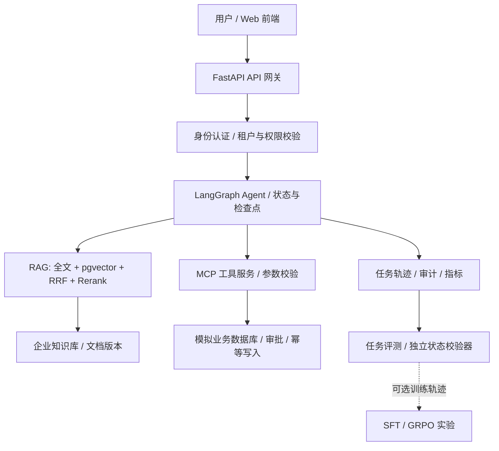

# Enterprise AgentOps-RL

> 面向企业知识密集型任务的可信 Agent 执行、RAG 检索和强化学习优化平台。

**当前阶段：项目规划（尚未实现业务代码）**  
**计划周期：2026-10-26 至 2027-01-17（12 周）**  
**每周投入：20–30 小时（按 25 小时规划）**  
**每月额外预算：0–100 元，优先利用已有 GPU**

## 项目目标

实现一个可本地部署、可复现、可用于求职演示的企业级 AI 系统：用户输入需要查询制度与执行工具的复杂业务任务；Agent 完成检索、规划、调用业务工具、校验业务状态、必要时请求人工审批，系统保留轨迹和评价指标。可选地用 SFT/GRPO 改进工具使用策略。

项目面向 **AI 应用开发 / RAG / Agent 算法 / LLM 后训练** 两类实习岗位，重点展示可解释的工程取舍、失败处理、自动化测试与对照实验。

## 业务场景与范围

- **主场景：模拟金融企业的政策检索与业务工单执行**，利用 [`τ-bench / τ-Knowledge`](https://github.com/sierra-research/tau2-bench) 中的公开业务规则、模拟环境和可验证任务。
- 首版限定 **一个业务领域、一个主 Agent、一个 MCP Server、5–8 个业务工具、两个模拟租户、四个 Web 页面**。
- 主线涵盖 RAG、Agent/MCP、FastAPI、PostgreSQL/pgvector、执行可靠性、权限、评测和部署。
- **SFT 必须在可用数据和环境验证器建立后开展；GRPO 属于有资源与时间门槛的扩展目标**，不可影响前 10 周的可演示系统。
- 不在第一版建设 Kubernetes 集群、复杂微服务或无必要的多 Agent 系统。

## 架构总览

**关键原则：** 工具执行的鉴权和写入保护在后端执行，不依赖模型遵守 Prompt；生产数据和训练数据隔离；评测器不依赖模型自评。

## 12 周路线（先工程，后算法）

| 周 | 日期 | 学习与开发重点 | 必须交付 |
|---|---|---|---|
| W1 | 10/26–11/01 | FastAPI、Pydantic、pytest、Docker | 健康检查、基础 API、测试与本地环境 |
| W2 | 11/02–11/08 | PostgreSQL、SQLAlchemy、Alembic、数据导入 | 核心业务表、迁移与可重复导入 |
| W3 | 11/09–11/15 | Chunk、Embedding、pgvector、全文检索 | 支持来源追踪的 RAG 检索 API |
| W4 | 11/16–11/22 | Hybrid、RRF、Reranker、IR 评测 | 四组检索基线及复现报告 |
| W5 | 11/23–11/29 | LangGraph、状态、记忆、Checkpoint | 多步任务 Agent 与恢复测试 |
| W6 | 11/30–12/06 | MCP、业务工具、Schema、人工审批 | MCP 工具服务、读写路径和调用记录 |
| W7 | 12/07–12/13 | 多租户、RBAC、幂等、失败恢复 | 权限与可靠性测试 |
| W8 | 12/14–12/20 | 任务 Verifier、Trace、Bad Case | Agent Benchmark 与评测报告 |
| W9 | 12/21–12/27 | React、TypeScript、SSE、前后端集成 | 四个 Web 页面与业务演示 |
| W10 | 12/28–01/03 | 负载测试、CI、Compose、文档 | **可演示 V1.0** |
| W11 | 01/04–01/10 | 轨迹数据构造、LoRA、SFT | SFT 基线与隔离测试 |
| W12 | 01/11–01/17 | GRPO（视资源）、消融、简历 | 可复现的模型比较及项目材料 |

完整的知识点、每日任务、交付文件与验收标准：[12 周详细计划](docs/ROADMAP.md)。

## 技术栈

- **API**：Python 3.12、FastAPI、Pydantic、SQLAlchemy、Alembic
- **数据与检索**：PostgreSQL、pgvector、全文检索、RRF、Reranker
- **Agent**：LangGraph、MCP Python SDK、带状态的工具执行
- **业务能力**：RBAC、租户过滤、审批、审计、幂等、恢复
- **Web**：React、Vite、TypeScript、SSE
- **验证**：pytest、Benchmark、Trace、Recall@K、MRR、nDCG、成功率、P95 延迟
- **训练（W11–W12）**：PyTorch、Transformers、PEFT、TRL；环境与 GPU 允许时测试 GRPO
- **部署**：Docker Compose、GitHub Actions

## 项目文档

| 文档 | 内容 |
|---|---|
| [docs/ROADMAP.md](docs/ROADMAP.md) | W1–W12 学习目标、任务与验收 |
| [docs/ARCHITECTURE.md](docs/ARCHITECTURE.md) | 系统边界、数据模型、MCP 工具、安全与可靠性 |
| [docs/DATA_AND_EVALUATION.md](docs/DATA_AND_EVALUATION.md) | 公共数据接入、数据泄漏隔离、基线和评测协议 |
| [docs/CAREER_ALIGNMENT.md](docs/CAREER_ALIGNMENT.md) | 算法与应用岗位的面试能力映射和求职交付 |
| [docs/WORKFLOW.md](docs/WORKFLOW.md) | 每周时间安排、开发原则、里程碑及质量门槛 |
| [docs/RESOURCES.md](docs/RESOURCES.md) | 官方学习资料与数据来源 |

## 里程碑

- [ ] **M1 / W2**：数据库与 API 通过自动化测试
- [ ] **M2 / W4**：检索基线和实验数据可复现
- [ ] **M3 / W6**：多步骤 Agent + MCP 工具可执行任务
- [ ] **M4 / W8**：权限、故障恢复和可验证评测通过
- [ ] **M5 / W10**：Web、部署、CI 和演示完成
- [ ] **M6 / W12**：SFT/（条件允许的）GRPO 实验及简历材料完成

## 当前项目状态

仓库当前仅包含**规划文档和预留目录**；尚未声称 API、RAG、Agent、训练或部署可运行。开始 W1 后按周提交可运行代码和测试结果。任何成功率、性能提升或模型实验结果必须通过实际执行得到，不允许把目标值写成已实现结果。

## 数据和安全说明

所有企业账户、工单、审批和租户均使用公开**模拟数据**。不会上传真实客户信息、API 密钥、个人隐私或未获授权的企业资料。公共基准的训练/验证/测试划分、数据版本及许可应单独记录；不能将基准标准答案或评测状态混入训练样本。
