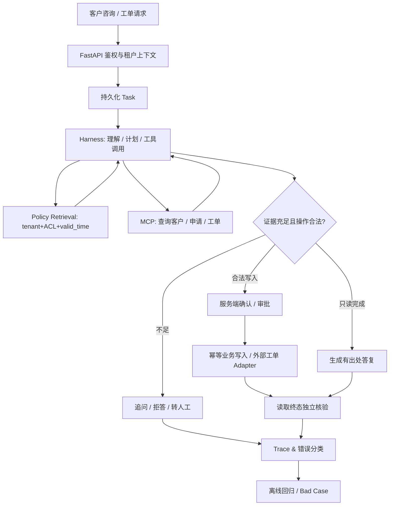

# 系统架构总纲｜企业 ServiceOps Agent Harness（设计稿）

> 本文是架构目标，不是已实现清单。以 [PRD](PRODUCT_SCOPE.md) 的业务任务、Gate 和后续 ADR/测试为验收依据。

## 1. 先确定边界：谁有权决定什么

系统采用**单体业务后端 + 独立 MCP/Mock 业务服务**的渐进式方案，避免为了技术栈而拆微服务。

| 层 | 职责 | 绝对不能委托给模型的事情 |
|---|---|---|
| FastAPI / API | 请求鉴权、限流与校验、任务 CRUD、SSE、OpenAPI | 假设模型已完成权限检查 |
| Business Domain | 客服工单状态机、审批、策略、事务、业务 Verifier | 由 LLM 自己决定是否有写权限 |
| Knowledge Service | 文档版本、有效期、权限过滤、Hybrid RAG、引用 | 对无权限或过期知识进行后验 Prompt 过滤 |
| Agent Harness | Agent Loop、工具选择、上下文预算、任务事件、拒答/转人工 | 自行提交被禁止的敏感写操作 |
| Runtime（可插拔） | 顺序执行、Checkpoints、HITL 中断、恢复 | 把 Checkpoint 视作 DB 事务 |
| MCP / Connectors | 已授权工具 Schema、远程 API、超时/重试、错误规范 | 对模型暴露原始数据库管理员或自由 Shell |
| AgentOps | Trace、离线回放、Bad Case、Verifier、指标 | 使用 LLM 自评作为业务完成唯一证据 |
| Training（可选） | 隔离 SFT/GRPO 与模型对照 | 在线任务使用训练期间的未验证权重 |

## 2. Harness 与 LangGraph 的关系

不以复杂流程图为先决条件，先完成一个有边界的 Tool Calling Loop：
- `AgentRunner.run(task, context, tools)`：返回结构化状态事件/最终结果。
- `ContextPolicy`：管理系统约束、证据、已执行动作与 token 预算。
- `ToolRegistry`：将工具名称映射为经过验证的 schema 和受控执行函数。
- `TaskStore`：存储任务状态、工具回执与恢复信息。
- `Verifier`：独立访问业务数据库，检查预期终态和禁止操作。
- `RuntimeAdapter`：初版顺序执行；确实需要审批中断与 Checkpoint 时使用 LangGraph。

**不把 LangGraph、Deep Agents 或某个 SDK 作为业务领域模型的上层依赖**。将来换 Runtime，CRM、工单、权限、知识服务及评测无需重写。

## 3. 业务流程与状态

任务主状态：`created`、`researching`、`waiting_for_user`、`waiting_for_approval`、`executing`、`verifying`、`succeeded`、`handed_off`、`failed`。任何状态变化都经过业务服务校验，敏感写入审批绑定请求参数哈希。

## 4. 拟定核心数据库实体

| 实体 | 主要字段 | 约束或用途 |
|---|---|---|
| `Tenant` | id, name, status | 两个隔离的模拟租户 |
| `User / Membership` | id, tenant_id, role | JWT 身份和资源授权 |
| `Document` | id, tenant_id, source, version, effective_at, expires_at, status, ACL | 持续有效知识和版本追踪 |
| `Chunk` | id, document_id, tenant_id, text, embedding, location | 检索与引用出处 |
| `Customer / Application` | id, tenant_id, owner_id, status | 公开数据衍生模拟客户 |
| `Task` | id, tenant_id, user_id, state, status, checkpoint_rev | 任务持久化及恢复 |
| `Case` | id, tenant_id, status, external_case_id, idempotency_key | 工单唯一性与外部回执 |
| `Approval` | id, tenant_id, reviewer_id, task_id, action_hash, decision | 防审批替换/重放 |
| `ToolCall` | id, task_id, tenant_id, tool_name, request_hash, external_ref, status | 执行审计与故障排查 |
| `EvalRun / EvalCase` | id, dataset_rev, config_rev, seed, verdict, costs | 重复评测与明细 |

最终 schema 必须以 Alembic 迁移、约束和测试为准。对官方 τ-bench 原始 schema 的改造应走导入适配层，不随意变更原始数据。

## 5. RAG 数据链路

导入源文件 → 解析与去重 → 文档版本/有效期/ACL 标记 → 结构化 Chunk → Embedding & PostgreSQL 全文检索 → Query 元数据过滤 → Sparse/Dense → RRF → 可选 Rerank → 提供 `doc_id/chunk_id/version` 引用。

**明确五类失败**：版本过期、权限不符、相近政策串线、检索不到证据、答案引用与实际证据不匹配。要有对应可执行测试，不以幻觉抑制 Prompt 代替知识治理。

## 6. 业务系统集成与 MCP

一个 MCP Server 首版允许 5–8 种业务工具。读工具/写工具分离；鉴权信息由可信服务端传递，不能将模型生成的 `tenant_id` 当真实身份。设计：
- `CRMAdapter`：本地模拟客户/申请状态 API。
- `TicketAdapter`：统一 `create_case/get_case/update_case` 及错误契约。
- `MockTicketAdapter`：独立 HTTP API，方便注入 429/5xx/超时、响应丢失、重试。
- `ZammadTicketAdapter`：W6–W8 实现，验证真实独立系统 API 和权限；不能未经联调宣称“已接企业平台”。

外部写入必须使用 idempotency key（自身数据库唯一键 + 外部结果关联）；外部系统未保证幂等时，通过本地操作日志、重试前查询和业务补偿实现“尽可能一次”，不得假称分布式 exactly-once。

## 7. 安全、恢复和观测

- API、业务服务、检索与工具四层验证 `tenant_id/user_id/resource_id`；可按实际 Postgres 角色能力增加 RLS，但不能只靠 RLS 替代业务鉴权。
- 审批/参数哈希/请求预算和操作授权在业务后端做；Prompt Injection 的输入隔离、工具白名单为强制措施。
- 每次操作记录 `trace_id/task_id/tenant_id`、模型/工具配置、错误码、延迟、Token 与返回引用；业务参数脱敏，不记录原始密钥和客户隐私。
- 长任务恢复：显式持久化待执行动作和回执；响应丢失时**先查询外部状态**，不能盲目再次执行写操作。
- Redis 用于可选缓存和短期协作；权威任务/审批/工单状态仍在 PostgreSQL。
- 任何情况下，模型自称“处理成功”不等于业务状态校验通过。

## 8. 可运行部署取舍

- 本机 WSL2 中项目与数据库优先在 ext4 文件系统；Docker Hub 被阻断时可使用 Ubuntu 原生 PostgreSQL/Redis，仍需可复现说明。
- 核心服务采用模块化单体便于一个人调试与学习。只有明确的部署边界（例如独立工单 API）才拆分服务。
- 性能指标固定请求集、并发、模型、硬件、数据和网络条件，测 P50/P95、吞吐、错误率与单任务成本。
- 本方案是模拟环境的**企业工程实践**，不是已通过金融行业安全/合规认证的软件。
